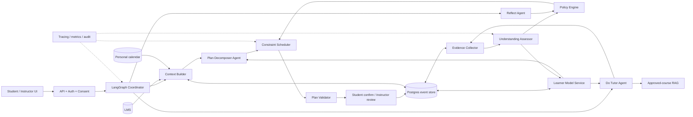

# PaceWise AI Plan–Do–Reflect: kiến trúc, bằng chứng và lộ trình đánh giá

> Trạng thái tài liệu: đề xuất kỹ thuật dựa trên audit repository ngày 07/10/2026.  
> Mục tiêu: biến PaceWise từ một workflow AI chạy được thành một hệ thống có thể **đo, kiểm chứng và cải thiện việc học**.  
> Phạm vi: Plan, Do, Reflect, Learner Model, Human-in-the-loop (HITL), eval và kiến trúc mở rộng.

## Trạng thái triển khai Plan Agent v2 — 07/10/2026

Phần Plan trong roadmap đã được triển khai ở backend theo kiến trúc hybrid:

- Assignment đủ cấu trúc đi qua template; assignment thiếu/phức tạp mới dùng LLM.
- Rubric được chuẩn hóa thành criteria có ID, trọng số, nguồn và báo cáo coverage.
- Milestone được map sang KC; KC ngoài metadata chính thức bị đánh dấu `provisional`.
- Mastery thấp tạo prerequisite review và tham gia phá hòa ưu tiên, nhưng không
  được vượt qua deadline gần hơn.
- Do/Reflect đã xác nhận được chuyển thành planning signal có giới hạn; free text
  không được thực thi trực tiếp thành thay đổi lịch.
- Estimate có P50/P80, evidence count, confidence và robust-capacity shortfall.
- Mỗi plan draft có quality evaluation độc lập trước khi sinh viên xác nhận.

Bằng chứng kỹ thuật tại thời điểm cập nhật: 284 backend tests, 110 frontend tests,
production build và 120 Plan Intelligence eval cases đều pass. Đây vẫn chỉ là
bằng chứng correctness của phần mềm; hiệu quả giáo dục cần pilot dài hạn như các
phase bên dưới.

## Trạng thái triển khai Instructor Foundation — 07/10/2026

Role giảng viên đã được mở rộng để cung cấp ground truth và HITL cho kiến trúc
Plan–Do–Reflect:

- Lịch dạy PaceWise hỗ trợ offline/online/thực hành/ôn tập/quiz/office hour,
  sửa, hủy, xóa và lặp theo tuần; lịch LMS luôn read-only.
- Lịch giảng viên đã xác nhận được đồng bộ thành calendar constraint chỉ đọc cho
  sinh viên. Plan vẫn phải preview/confirm trước khi thay đổi lịch cá nhân.
- Course Knowledge Graph quản lý module, knowledge component, prerequisite,
  objective và misconception; backend từ chối reference sai và dependency cycle.
- Học liệu có upload, preview, download, vector indexing và revoke.
- Assessment governance giữ question/rubric versioning và review queue cho ca AI
  confidence thấp.
- Feedback/can thiệp hỗ trợ phạm vi lớp/nhóm, lọc nhóm bằng membership LMS và
  thời lượng ôn tập có giới hạn;
  đây là planning recommendation, không phải lệnh sửa lịch.
- Privacy threshold, consent và individual-review policy được cấu hình theo môn,
  nhưng ngưỡng tổng hợp không được thấp hơn năm sinh viên.

Chi tiết contract và bằng chứng kiểm thử nằm tại
`docs/specs/instructor-role-foundation.md`.

## Trạng thái triển khai Do + Adaptive Assessment MVP — 07/10/2026

Phase 2 đã được triển khai theo đúng scope Plan → Do → Reflect; Assessment là
sub-agent trong phiên Do, không có tab nghiệp vụ riêng:

- Do checkpoint chỉ dùng câu hỏi/rubric/KC đã được giảng viên duyệt từ server;
  client không gửi đáp án chuẩn.
- Câu đóng được chấm theo kiểu dữ liệu xác định; các false accept `Apple/Ant`
  và `10/11` đã bị chặn. Đáp án đóng đúng chỉ tạo evidence ở mức recognition.
- `LearningEvidence`, `LearningEvent` và `KnowledgeStateSnapshot` là các record
  có version, provenance và event key idempotent. Retry không tạo bằng chứng trùng.
- Thiếu evidence/evaluator/rubric, confidence thấp, KC chưa map hoặc đang chờ
  giảng viên đều không được nâng Knowledge State.
- Hint level và first-attempt được lưu; H4/H5 không thể tạo transfer/retained.
- Reflect đọc Knowledge State đã kiểm định và chỉ phát planning signal có biên;
  không tự chấm mastery hoặc tự sửa lịch.
- Giảng viên có thể map câu hỏi vào KC đã duyệt, chọn kiểu chấm và mức bằng chứng.

Bằng chứng kỹ thuật: Ruff pass, 303 backend tests, 114 frontend tests,
TypeScript typecheck và production build pass. Offline eval `2026-10-07.v3`
gồm 140 assessment truth/gate cases đạt closed-evaluator accuracy 1.0,
knowledge-update-gate accuracy 1.0 và false-mastery acceptance 0.0.

Trạng thái công bố vẫn là **offline validated, not yet validated with real
learners**. Chưa có cơ sở tuyên bố cải thiện learning outcome, calibration,
retention hoặc agreement với giảng viên trước Phase 6.

## Trạng thái triển khai Do + Adaptive Assessment MVP — 07/10/2026

Phase 2 đã được triển khai theo đúng scope Plan → Do → Reflect; Assessment là
sub-agent trong phiên Do, không có tab nghiệp vụ riêng:

- Do checkpoint chỉ dùng câu hỏi/rubric/KC đã được giảng viên duyệt từ server;
  client không gửi đáp án chuẩn.
- Câu đóng được chấm theo kiểu dữ liệu xác định; các false accept `Apple/Ant`
  và `10/11` đã bị chặn. Đáp án đóng đúng chỉ tạo evidence ở mức recognition.
- `LearningEvidence`, `LearningEvent` và `KnowledgeStateSnapshot` là các record
  có version, provenance và event key idempotent. Retry không tạo bằng chứng trùng.
- Thiếu evidence/evaluator/rubric, confidence thấp, KC chưa map hoặc đang chờ
  giảng viên đều không được nâng Knowledge State.
- Hint level và first-attempt được lưu; H4/H5 không thể tạo transfer/retained.
- Reflect đọc Knowledge State đã kiểm định và chỉ phát planning signal có biên;
  không tự chấm mastery hoặc tự sửa lịch.
- Giảng viên có thể map câu hỏi vào KC đã duyệt, chọn kiểu chấm và mức bằng chứng.

Bằng chứng kỹ thuật: Ruff pass, 299 backend tests, 112 frontend tests,
TypeScript typecheck và production build pass. Offline eval `2026-10-07.v3`
gồm 140 assessment truth/gate cases đạt closed-evaluator accuracy 1.0,
knowledge-update-gate accuracy 1.0 và false-mastery acceptance 0.0.

Trạng thái công bố vẫn là **offline validated, not yet validated with real
learners**. Chưa có cơ sở tuyên bố cải thiện learning outcome, calibration,
retention hoặc agreement với giảng viên trước Phase 6.

## 1. Kết luận chốt

PaceWise **không nên chứng minh sinh viên hiểu bài bằng một câu trả lời của LLM**. “Hiểu bài” là trạng thái ẩn, không quan sát trực tiếp được. Hệ thống chỉ nên suy luận mức độ làm chủ từng đơn vị kiến thức từ nhiều bằng chứng độc lập:

1. Nhớ lại mà chưa nhận trợ giúp.
2. Giải thích được lý do/cách làm.
3. Áp dụng được vào bài tương tự hoặc bài chuyển giao.
4. Làm lại được sau một khoảng trì hoãn.
5. Mức phụ thuộc vào hint, tài liệu và chatbot.

Kiến trúc phù hợp nhất không phải là nhiều agent tự do tranh luận với nhau. Nên giữ ba workflow người dùng nhìn thấy — **Plan, Do, Reflect** — và đặt các dịch vụ xác định ở giữa:

- LLM chỉ tạo đề xuất, phân rã nhiệm vụ, hội thoại và trích xuất bằng chứng có cấu trúc.
- Scheduler quyết định lịch bằng constraint/rule, không để LLM tự ghi giờ.
- Learner Model cập nhật từ evidence đã kiểm định, không từ cảm giác của agent.
- Policy Engine ánh xạ evidence sang hành động tiếp theo.
- Sinh viên xác nhận thay đổi lịch; giảng viên duyệt rubric, câu hỏi và các ca không chắc chắn.

Với code hiện tại, nhóm có thể nói:

> PaceWise đã có prototype khép kín Plan → Do → Reflect, có lưu trạng thái, RAG, quality gate và HITL.

Nhóm **chưa nên nói**:

> PaceWise đã chứng minh chính xác sinh viên thực sự hiểu bài hoặc đã cải thiện kết quả học tập.

Hai tuyên bố sau chỉ hợp lệ sau khi có bộ dữ liệu do giảng viên gán nhãn, kiểm định độ tin cậy, bài kiểm tra không có AI và pilot có thiết kế đối chứng.

---

## 2. Audit repository hiện tại

### 2.1 Những nền tảng đã có và nên giữ

| Thành phần | Hiện trạng trong repository | Đánh giá |
|---|---|---|
| Orchestration | `src/agents/graph.py` có coordinator, các workflow Plan, Do, Tracking, QA, Understanding, Recover, Reflect và quality gate | Giữ; coordinator chỉ nên route, không ra quyết định học vụ |
| Plan decomposition | `src/agents/workflows/plan.py` dùng LLM phân rã assignment thành milestone có dependency, estimate và source reference | Giữ; bắt buộc structured schema, nguồn và student confirmation |
| Scheduling | `src/services/planning.py` xếp block theo deadline, capacity, availability, priority và pinned block | Đúng hướng vì deterministic; nên nâng lên optimizer khi constraint phức tạp |
| Do | `src/agents/workflows/do.py` chuẩn bị phiên học, lấy tài nguyên LMS, ghi actual time, completion và blocker | Nâng thành tutoring/evidence workflow, không chỉ là timer |
| Understanding | `src/agents/workflows/understanding.py` có câu đóng và chấm câu mở theo rubric | Có khung tốt nhưng chưa đủ validity để kết luận mastery |
| Reflect | `src/agents/workflows/reflect.py` có reflection theo hoạt động/tuần và yêu cầu xác nhận trước khi lưu | Giữ hai cấp: micro-reflect sau mốc và weekly-reflect |
| Long-term memory | `src/services/agent_memory.py` lưu profile, mastery, misconception, history trong Postgres | Tách narrative memory khỏi evidence/mastery model có version |
| Validation | `src/agents/validators.py` kiểm rubric, evidence và confidence | Cần thêm kiểm tính đúng, calibration, contradiction và human agreement |
| Observability | `src/observability.py` có HTTP/agent/RAG metrics | Thêm token/cost, latency từng node, calibration drift, HITL load |
| Frontend pilot metrics | `frontend/pacewise/src/utils/pilotMetrics.ts` có coverage, on-time, estimate MAE, recovery | Hữu ích cho vận hành; không phải bằng chứng hiểu bài |

### 2.2 Ba lỗ hổng phải nói thẳng

#### P0 — chấm câu đóng có thể false positive

Kiểm tra nhắm mục tiêu cho thấy evaluator hiện tại có thể nhận:

- `Apple` và `Ant` là đúng.
- `10` và `11` là đúng.

Nguyên nhân là logic nhận diện option lấy ký tự/chữ số đầu ngay cả khi đầu vào không thực sự là nhãn lựa chọn. Kết quả câu đóng vì vậy **chưa được phép cập nhật mastery**.

Quy tắc sửa:

- Chỉ coi `A`, `A.`, `(A)` hoặc `option A` là nhãn đáp án khi schema của câu hỏi khai báo lựa chọn.
- Câu số dùng parse kiểu số + tolerance do item quy định.
- Câu text dùng normalize rồi exact match hoặc tập đáp án được giảng viên duyệt.
- Không dùng fuzzy/substring match để kết luận đúng trong assessment.

#### P0 — eval understanding đang tự xác nhận chính nó

`src/agents/evaluation.py` tạo dữ liệu synthetic trong đó JSON đầu vào đã chứa trạng thái kỳ vọng rồi parser đọc lại trạng thái đó. Macro-F1 cao ở đây chủ yếu chứng minh parser đọc đúng, **không chứng minh agent chẩn đoán đúng câu trả lời sinh viên**.

Bộ eval thay thế phải chứa:

- Câu hỏi, knowledge component (KC), reference answer và rubric do giảng viên duyệt.
- Câu trả lời thực/synthetic nhưng không chứa nhãn trong prompt.
- Nhãn độc lập của ít nhất hai người chấm, sau đó adjudication.
- Split theo item/KC hoặc lớp, tránh cùng một mẫu lọt vào train và test.

#### P1 — demo clock và các heuristic chưa phải production truth

Một số luồng frontend đang dùng mốc demo 05/10/2026; estimate được điều chỉnh bằng EMA theo môn. Đây là lựa chọn hợp lý cho demo nhưng production cần:

- Clock và timezone được inject từ server/user profile.
- Backfill/migration rõ ràng cho dữ liệu demo.
- Estimate theo hierarchy: global → course → task type → KC, có shrinkage khi mẫu ít.
- Không học từ một reflection đơn lẻ như thể đó là sự thật.

### 2.3 Ý nghĩa của `evaluation-evidence.md` hiện tại

Các test workflow, RAG, guardrail và frontend đang trả lời câu hỏi:

> Phần mềm có chạy đúng contract kỹ thuật không?

Chúng chưa trả lời:

> Chẩn đoán có đồng thuận với giảng viên không? Sinh viên có còn làm được sau 7 ngày và khi không dùng AI không?

Do đó cần giữ hai báo cáo riêng:

- **Software evidence:** unit, integration, E2E, load, security.
- **Learning evidence:** validity, reliability, retention, transfer, calibration và causal pilot.

---

## 3. Định nghĩa vận hành: thế nào là “thực sự hiểu bài”?

### 3.1 Không đo “hiểu môn”, đo từng Knowledge Component

Một KC là kỹ năng/khái niệm đủ nhỏ để ra nhiệm vụ và quan sát được, ví dụ với Toán rời rạc:

- `R3.1.DEF`: nhận diện và biểu diễn quan hệ hai ngôi.
- `R3.1.PROP`: kiểm tra phản xạ, đối xứng, phản đối xứng, bắc cầu.
- `R3.2.EQUIV`: chứng minh quan hệ tương đương và lập lớp tương đương.
- `R3.3.ORDER`: phân biệt thứ tự toàn phần/bộ phận và dựng Hasse.

Assignment, quiz, milestone và tài liệu đều phải map đến một hoặc nhiều KC có version.

### 3.2 Năm trục bằng chứng

| Trục | Bằng chứng nên thu | Không được thay thế bằng |
|---|---|---|
| Retrieval | First attempt không hint, câu ngắn hoặc bài làm | Đã mở tài liệu hoặc học đủ phút |
| Explanation | Giải thích “vì sao”, rubric theo tiêu chí | Đáp án cuối đúng nhưng không có lập luận |
| Application/transfer | Bài mới cùng KC nhưng khác bề mặt/ngữ cảnh | Lặp lại đúng câu vừa được AI giải |
| Retention | Kiểm tra lại sau 24–72 giờ và khoảng 7 ngày | Điểm ngay sau khi học |
| Independence | Số hint, mức hint, có lộ đáp án hay không | Tự báo cáo “em hiểu rồi” |

Nghiên cứu phân biệt rõ performance trong lúc luyện và learning bền vững; performance tức thời có thể là chỉ báo không đáng tin cho retention/transfer. Vì vậy PaceWise phải có delayed check, không dùng trạng thái “hoàn thành phiên Do” làm mastery ([Soderstrom & Bjork, 2015](https://pubmed.ncbi.nlm.nih.gov/25910388/)).

### 3.3 Bốn trạng thái dùng trong sản phẩm

| Trạng thái | Điều kiện vận hành đề xuất |
|---|---|
| `insufficient_evidence` | Chưa có first-attempt không trợ giúp, hoặc quá ít quan sát độc lập |
| `misconception` | Lỗi khái niệm lặp lại/được rubric chỉ ra; ca nghiêm trọng cần giảng viên xác nhận |
| `forming` | Đúng một phần hoặc làm được bài gần nhưng chưa có delayed/transfer evidence |
| `demonstrated` | Đủ bằng chứng không trợ giúp, giải thích/áp dụng, và delayed hoặc transfer; không có mâu thuẫn chưa xử lý |

Ngưỡng MVP đề xuất cho `demonstrated`:

- Ít nhất 3 evidence trên ít nhất 2 thời điểm.
- Có ít nhất 1 first-attempt không hint.
- Có ít nhất 1 evidence delayed hoặc transfer.
- Điểm evidence chuẩn hóa có trọng số đạt ngưỡng tạm thời, ví dụ `mastery_probability >= 0.80`.
- Không có misconception mới hơn chưa được xử lý.

`0.80` là **ngưỡng sản phẩm khởi tạo**, không phải hằng số khoa học. Nó phải được hiệu chỉnh bằng dữ liệu pilot và đường calibration.

### 3.4 Tự đánh giá có vai trò gì?

Confidence/self-report giúp phát hiện metacognition:

```text
calibration_gap = self_confidence_probability - actual_unassisted_correctness
```

- Gap dương lớn: có thể quá tự tin → ưu tiên retrieval/transfer check.
- Gap âm lớn: có thể thiếu tự tin dù làm được → phản hồi khích lệ và giảm scaffolding dần.

Không dùng self-report làm bằng chứng chính. Thí nghiệm active learning cho thấy cảm giác học và kết quả học thực tế có thể đi ngược nhau ([Deslauriers et al., 2019](https://doi.org/10.1073/pnas.1821936116)).

---

## 4. Kiến trúc mục tiêu: bounded multi-agent + deterministic core



### 4.1 Vì sao không nên biến mọi khối thành agent?

Agent phù hợp khi cần hiểu ngôn ngữ, tổng hợp ngữ cảnh hoặc tạo đề xuất. Rule/service phù hợp khi kết quả phải lặp lại và kiểm toán được.

| Khối | Nên là | Lý do |
|---|---|---|
| Coordinator | Graph/router | Điều phối trạng thái và resume |
| Context Builder | Deterministic service | Phân quyền, chuẩn hóa dữ liệu, chống prompt injection |
| Plan Decomposer | LLM agent | Syllabus/assignment là ngôn ngữ tự nhiên |
| Scheduler | Constraint solver/rules | Deadline, no-overlap, availability phải đúng tuyệt đối |
| Do Tutor | LLM agent có guardrail | Cần hội thoại thích nghi và RAG |
| Evidence Collector | Event service | Không được mất/ghi trùng bằng chứng |
| Understanding Assessor | Hybrid | Câu đóng deterministic; câu mở rubric + LLM + HITL |
| Learner Model | Statistical service | Cần version, calibration và khả năng recompute |
| Reflect | LLM agent | Tóm tắt pattern và đặt câu hỏi phản tư |
| Policy Engine | Rule/config service | Quyết định tác động lịch phải minh bạch |

### 4.2 Nguyên tắc quyền ghi

- Plan Agent chỉ ghi `plan_proposal`.
- Scheduler chỉ tạo `schedule_candidate`.
- Student confirmation mới tạo `schedule_committed`.
- Understanding Agent chỉ tạo `assessment_proposal` và evidence quote.
- Learner Model chỉ cập nhật khi evidence qua validator/policy.
- Reflect Agent chỉ tạo `reflection_summary` và `adjustment_proposal`.
- Policy Engine quyết định `next_action`; thay đổi lớn hoặc confidence thấp đi qua HITL.

### 4.3 Dữ liệu cốt lõi cần bổ sung

| Bảng/event | Trường tối thiểu |
|---|---|
| `knowledge_component` | `kc_id`, course, title, prerequisite, version, active |
| `task_kc` | task/item, `kc_id`, contribution weight, teacher approval |
| `assessment_item` | item version, type, KC, reference answer, rubric version, difficulty metadata |
| `learning_evidence` | student, KC, item, timestamp, first attempt, answer, score, hint level, source, evaluator version |
| `mastery_snapshot` | student, KC, probability/status, uncertainty, evidence count, as-of time, model version |
| `misconception` | student, KC, pattern, supporting evidence IDs, status, reviewer |
| `intervention` | trigger, action, target KC/task, accepted, completed, outcome |
| `agent_run` | workflow, model/prompt/schema version, latency, tokens, cost, status, trace ID |
| `review_case` | reason, evidence IDs, proposed label, reviewer decision, SLA |

`learning_evidence` nên append-only. `mastery_snapshot` là dữ liệu dẫn xuất và có thể tính lại khi rubric/model thay đổi.

### 4.4 Idempotency và LangGraph HITL

Interrupt có thể khiến node chạy lại từ đầu. Tài liệu LangGraph yêu cầu side effect trước interrupt phải idempotent hoặc tách sang node sau interrupt ([LangGraph interrupts](https://docs.langchain.com/oss/python/langgraph/interrupts)).

Áp dụng:

```text
idempotency_key = student_id + workflow + activity_id + attempt_no + event_type
```

- Unique index trên `idempotency_key`.
- Dùng upsert cho proposal/review request.
- Không gửi notification hoặc cộng evidence trước điểm resume nếu chưa bảo đảm idempotent.
- Thread/checkpoint memory không được coi là long-term learner model.

---

## 5. Luồng chuẩn của từng agent

### 5.1 Plan workflow

#### Input

- Assignment/syllabus/rubric/module/prerequisite từ LMS.
- Lịch lớp read-only và deadline từ LMS.
- Lịch cá nhân, giờ ngủ, giờ tự học, preferred hours và pinned blocks do sinh viên nhập.
- Thời điểm hiện tại và timezone thật.
- Remaining work, estimate history, mastery/misconception theo KC.
- Priority của giảng viên và priority 1–4 của sinh viên.

#### Processing

1. Context Builder lọc dữ liệu theo course/user và đánh dấu trusted/untrusted.
2. Decomposer tạo milestone có deliverable, dependency, KC, nguồn và estimate range.
3. Estimate service tạo `p50`, `p80` và confidence, không chỉ một con số.
4. Scheduler xếp từ `now`, tuyệt đối không sửa quá khứ.
5. Constraint Validator kiểm deadline, no-overlap, availability, prerequisite và buffer.
6. UI preview diff; sinh viên confirm trước khi commit.

#### Output

- Kế hoạch tuần hiện tại từ thời điểm bây giờ.
- Preview tuần kế tiếp dưới trạng thái tentative nếu có deadline/công việc liên quan.
- Danh sách unscheduled task với lý do cụ thể: thiếu capacity, prerequisite, không có slot trước deadline.
- Explanation ngắn: “vì deadline”, “vì KC đang yếu”, “vì block trước bị bỏ lỡ”.

#### Objective của scheduler tương lai

Hard constraints:

- Không nằm trong quá khứ.
- Không trùng LMS class, personal busy/sleep/eating block.
- Hoàn thành prerequisite trước successor.
- Tổng block không vượt remaining minutes.
- Pinned block không tự di chuyển.

Soft objective ví dụ:

```text
minimize(
  10 * deadline_lateness
  + 6 * capacity_shortage
  + 4 * context_switches
  + 3 * preferred_hour_violation
  + 3 * high_risk_KC_delay
  + 2 * schedule_churn
)
```

CP-SAT phù hợp khi constraint tăng vì hỗ trợ precedence và no-overlap; tuy vậy hàm mục tiêu học tập vẫn phải do PaceWise định nghĩa, không bê nguyên job-shop objective ([Google OR-Tools scheduling](https://developers.google.com/optimization/scheduling/job_shop)).

### 5.2 Do workflow

#### Điều kiện kích hoạt

- Chỉ mở đúng study block đã commit; demo có thể nới guard thời gian nhưng production phải cấu hình rõ.
- Trước phiên, system snapshot: task, KC, planned minutes, prior evidence, allowed resources.

#### Luồng trong phiên

1. Hiện mục tiêu nhỏ và deliverable của block.
2. Lấy tài liệu đã được duyệt, có trích trang/đoạn.
3. Cho student first attempt trước khi chatbot trợ giúp.
4. Tutor dùng hint ladder:
   - H0: không hint.
   - H1: câu hỏi gợi mở.
   - H2: nhắc khái niệm/công thức liên quan.
   - H3: chỉ ra bước tiếp theo.
   - H4: worked example khác dữ kiện.
   - H5: lộ lời giải; evidence sau đó không được tính là độc lập.
5. Ghi completion, actual minutes, blocker và evidence.
6. Kết thúc bằng một retrieval/transfer check ngắn không có AI.

Một RCT gần 1.000 học sinh cho thấy AI không guardrail tăng điểm khi được trợ giúp nhưng nhóm dùng giao diện AI cơ bản thấp hơn control 17% ở bài thi không có AI; phiên bản tutor dùng hint/teacher input giảm phần lớn tác hại đó. Vì vậy PaceWise phải đánh giá bằng bài **unassisted**, không bằng chất lượng đoạn chat ([Bastani et al., 2025](https://www.pnas.org/doi/10.1073/pnas.2422633122)).

Retrieval practice cũng có bằng chứng cải thiện meaningful learning và câu hỏi suy luận; đây là lý do cho first-attempt và exit check thay vì chỉ đọc lại tài liệu ([Karpicke & Blunt, 2011](https://pubmed.ncbi.nlm.nih.gov/21252317/)).

#### Output

- `do_session_completed` hoặc `do_session_abandoned`.
- Evidence theo KC, mức trợ giúp và evaluator version.
- Remaining minutes được hiệu chỉnh.
- `next_action`: continue, review, delayed check, recover schedule hoặc instructor review.

### 5.3 Reflect workflow

#### Micro-reflect sau mỗi mốc

Áp dụng cho ca học trên lớp/online, phiên tự học, quiz, assignment hoặc ôn tập. Câu hỏi tối đa 2–3 câu:

- Mục tiêu nào đã đạt/chưa đạt?
- Blocker chính là kiến thức, thời gian, môi trường hay kế hoạch?
- Phần nào cần kiểm tra lại thay vì “em cảm thấy chưa hiểu”? 

Micro-reflect không tự động thay lịch sau từng câu trả lời. Nó tạo evidence/context và chỉ kích hoạt policy khi vượt ngưỡng.

#### Weekly-reflect

Tổng hợp:

- Planned vs actual time.
- On-time/completion.
- KC demonstrated/forming/misconception/insufficient.
- Hint dependence và delayed-check result.
- Estimate error theo course/task type.
- Các pattern lặp lại ít nhất hai lần.

Reflect Agent đưa tối đa 3 đề xuất có lý do. Policy Engine phân loại:

- Thay đổi nhỏ, đảo block chưa bắt đầu: preview cho sinh viên xác nhận.
- Thay đổi workload/deadline/prerequisite: không tự đổi dữ liệu LMS.
- Risk nghiêm trọng/lặp lại hoặc safety concern: tạo review case cho giảng viên theo consent và data-minimization.

#### Vòng feedback sang Plan

Reflect không truyền nguyên đoạn văn tự do cho Plan. Nó cập nhật feature có version:

```json
{
  "course_id": "MATH-DM",
  "task_type": "proof",
  "kc_id": "R3.2.EQUIV",
  "estimate_ratio_ema": 1.35,
  "preferred_session_minutes": 45,
  "effective_hour_buckets": ["20:00-22:00"],
  "misconception_open": true,
  "evidence_count": 6,
  "confidence": 0.72
}
```

Plan chỉ dùng feature nếu đủ mẫu/confidence. Bài hoặc môn tuần sau có thể khác, nên áp dụng hierarchy:

```text
estimate = global_prior
         × course_factor
         × task_type_factor
         × KC_difficulty_factor
         × learner_factor
```

Mẫu ít thì shrink về `global_prior`; không bê nguyên thời gian của bài tuần trước sang môn mới.

---

## 6. Mô hình evidence và mastery

### 6.1 Evidence-Centered Design

PaceWise nên triển khai ba model:

1. **Student model:** muốn suy luận năng lực/KC nào?
2. **Task model:** nhiệm vụ nào có thể làm lộ năng lực đó?
3. **Evidence model:** đặc điểm nào của sản phẩm học tập hỗ trợ/đi ngược kết luận?

Đây là ứng dụng trực tiếp của Evidence-Centered Design: biến trạng thái không quan sát được thành suy luận dựa trên nhiệm vụ và bằng chứng, thay vì coi output LLM là ground truth ([Mislevy, Almond & Lukas, 2003](https://www.ets.org/research/policy_research_reports/publications/report/2003/hsgs.html)).

### 6.2 Scoring MVP minh bạch

Trước khi đủ dữ liệu cho mô hình xác suất, dùng evidence rule có giải thích:

```text
evidence_score = item_score
               × independence_weight
               × evidence_type_weight
               × recency_weight
               × item_quality_weight
```

Ví dụ weight khởi tạo để pilot, không phải giá trị khoa học cố định:

| Thuộc tính | Weight ví dụ |
|---|---:|
| First attempt, H0 | 1.00 |
| H1–H2 | 0.75 |
| H3–H4 | 0.40 |
| H5/lộ lời giải | 0.00 cho mastery, vẫn lưu process evidence |
| Same-form retrieval | 0.80 |
| Near transfer | 1.00 |
| Far transfer | 1.15 |
| Delayed 24–72h | 1.10 |
| Delayed khoảng 7 ngày | 1.20 |

Không cộng thẳng các weight này thành “điểm chính thức”. Chúng dùng để xếp evidence và tạo status tạm thời; phải calibrate theo human-labeled data.

### 6.3 Giai đoạn sau: Bayesian Knowledge Tracing

BKT duy trì xác suất sinh viên đã học mỗi skill/rule qua chuỗi cơ hội làm bài và từng được dùng để cá nhân hóa bài tiếp theo ([Corbett & Anderson, 1994/1995](https://link.springer.com/article/10.1007/BF01099821)). Chỉ triển khai khi:

- KC tagging ổn định và được giảng viên duyệt.
- Có đủ lượt làm theo KC để ước lượng learn/slip/guess.
- Có held-out student/item split.
- BKT cải thiện log-loss/Brier/AUC so với heuristic baseline.

Không dùng Deep Knowledge Tracing chỉ vì “AI hơn” khi dataset còn nhỏ; mô hình phức tạp dễ overfit và khó giải thích.

---

## 7. Metrics, cách test và ngưỡng promotion

Các ngưỡng dưới đây là **release gate đề xuất**, không phải kết quả đã đạt.

### 7.1 Software correctness và safety

| Metric | Công thức/cách test | Gate đề xuất |
|---|---|---:|
| Closed-answer exactness | Correct decision / adversarial cases | 100%; false accept số/text = 0 |
| Schedule hard-constraint violation | Violating committed blocks / committed blocks | 0% |
| No-past invariant | Blocks newly scheduled before `now` | 0 |
| Idempotency | Duplicate logical events after retry/resume | 0 |
| Citation precision | Supported citations / checked citations | ≥95% |
| Citation coverage | Claims needing source with valid source / all such claims | ≥95% |
| Unsafe direct-answer rate | H5/direct answers before required attempt / guarded sessions | ≤1% |
| Escalation recall | Correctly escalated low-confidence/out-of-rubric cases / all gold escalation cases | ≥95% |

Adversarial suite tối thiểu cho closed evaluator:

- `Apple` vs `Ant` → false.
- `10` vs `11` → false.
- `A` vs option `A. ...` trong item MCQ → true.
- `A` vs text answer `Apple` không phải MCQ → false.
- `1/2` vs `0.5` chỉ true khi item cho numeric equivalence.
- Unicode, khoảng trắng, dấu tiếng Việt và prompt injection trong answer.

### 7.2 Diagnostic validity

Gold set cần hai giảng viên/chuyên gia chấm độc lập, blind với output AI; bất đồng được adjudicate.

| Metric | Ý nghĩa | Gate đề xuất |
|---|---|---:|
| Human weighted Cohen’s κ | Trần độ tin cậy giữa người chấm | Báo cáo thực; mục tiêu ≥0.70 |
| Macro-F1 AI vs adjudicated label | Không để lớp phổ biến che lớp yếu | ≥0.80 |
| Recall mỗi status | Tránh bỏ sót misconception | ≥0.70 mỗi lớp |
| High-confidence error | Sai nhưng confidence ≥0.8 / mọi ca confidence ≥0.8 | ≤5% |
| Evidence faithfulness | Evidence quote thực sự hỗ trợ label | ≥95% qua human audit |
| Exact repeat consistency | Cùng input/rubric/model snapshot cho cùng status | ≥95% |
| Brier score | Trung bình `(p - y)^2`; thấp hơn tốt | Tốt hơn frequency baseline ≥10% |
| Expected Calibration Error | Chênh confidence–accuracy theo bin | ≤0.10 |

Confidence từ model không mặc định đáng tin. Nghiên cứu calibration cho thấy mô hình có thể dự đoán đúng nhưng xác suất confidence bị lệch; cần reliability diagram, Brier/ECE và calibration set riêng ([Guo et al., 2017](https://proceedings.mlr.press/v70/guo17a.html)).

LLM-as-judge còn có position, verbosity và self-enhancement bias, nên không dùng một LLM judge làm gold label ([Zheng et al., 2023](https://arxiv.org/abs/2306.05685)). Với câu mở, reference answer và rubric do giảng viên cung cấp giúp output gần đánh giá giảng viên hơn so với rubric không được kiểm soát ([Golchin et al., 2025](https://aclanthology.org/2025.coling-main.263/)).

### 7.3 Learning outcome

| Metric | Cách đo | Vai trò |
|---|---|---|
| Immediate unassisted score | Exit item không AI ngay cuối Do | Chỉ báo ngắn hạn |
| Delayed retention | Điểm item tương đương sau 24–72h và khoảng 7 ngày | Primary evidence cho nhớ bền |
| Near/far transfer | Item cùng KC nhưng đổi bề mặt/mức mới | Primary evidence cho vận dụng |
| Hint independence | Tỷ lệ đúng H0/H1; median max-hint | Phát hiện phụ thuộc AI |
| Mastery transition precision | `demonstrated` rồi pass delayed/transfer | Kiểm status có ý nghĩa dự báo |
| Calibration gap | Confidence tự báo − correctness | Metacognition, không phải mastery |
| Learning gain | Posttest − pretest, chuẩn hóa khi phù hợp | So sánh tiến bộ |

Primary endpoint pilot nên là **delayed unassisted score hoặc transfer score**, không phải số phút học, số tin nhắn hay cảm giác hiểu.

### 7.4 Product outcome

| Metric | Công thức |
|---|---|
| On-time submission rate | Bài nộp đúng hạn / bài đến hạn |
| Plan coverage | Phút workload có block / tổng phút workload đủ điều kiện |
| Adherence | Study blocks hoàn thành / committed study blocks |
| Estimate WAPE | `sum(abs(actual-estimate)) / sum(actual)` |
| Recovery success | Risk cases trở lại feasible trong SLA / risk cases đã accept recovery |
| Action precision | Đề xuất được accept và cải thiện metric mục tiêu / đề xuất đã áp dụng |
| Unnecessary churn | Block bị dời không tạo lợi ích / block đã dời |

WAPE phù hợp hơn MAPE khi actual minutes nhỏ/0; vẫn báo MAE theo phút để người dùng dễ hiểu.

### 7.5 System, chi phí và vận hành

- p50/p95/p99 latency theo node và toàn cycle.
- Tokens, chi phí và số LLM calls trên một Plan/Do/Reflect thành công.
- Cache hit rate của RAG/context.
- Timeout, fallback và structured-output repair rate.
- HITL queue age, escalation rate và reviewer turnaround.
- Event duplication, checkpoint resume success.
- Drift theo prompt/model/rubric version.

### 7.6 Fairness và subgroup

- Báo Macro-F1, calibration và false-high-confidence theo course, trình độ đầu vào, ngôn ngữ trả lời và accessibility group khi đủ mẫu.
- Flag nếu chênh F1/ECE giữa subgroup >0.10 để human review; không kết luận fairness khi `n` quá nhỏ.
- Không gửi reflection riêng tư cho giảng viên mặc định; chỉ gửi risk tối thiểu cần thiết theo consent/policy.

---

## 8. Thiết kế bộ eval đúng

### 8.1 Bộ unit/adversarial

- ≥100 case câu đóng theo type: MCQ, numeric, boolean, exact text, set/logic notation.
- Property-based tests cho whitespace, Unicode và serialization.
- Scheduler fuzz test: random availability/deadline/pinned blocks; assert hard constraints.
- Retry/resume fault injection tại từng interrupt.

### 8.2 Bộ gold understanding

Tối thiểu ban đầu 200–320 câu trả lời, cố gắng ≥40 mẫu mỗi status. Nếu phân bố thật không cân bằng, giữ phân bố thật cho test cuối và dùng stratified dev set.

Mỗi record gồm:

```json
{
  "item_id": "R3.2-EQ-07-v2",
  "kc_ids": ["R3.2.EQUIV"],
  "prompt": "...",
  "student_answer": "...",
  "first_attempt": true,
  "hint_level": 0,
  "reference_answer_version": "v2",
  "rubric_version": "v3",
  "rater_1": "forming",
  "rater_2": "misconception",
  "adjudicated_label": "misconception"
}
```

Không chứa `adjudicated_label` trong input gửi agent. Split theo student và item family để giảm leakage.

### 8.3 Bộ longitudinal

Mỗi KC cần cặp/nhóm item:

- Pretest.
- Immediate exit check.
- Delayed 24–72h.
- Delayed khoảng 7 ngày.
- Near hoặc far transfer.

Spaced retrieval có bằng chứng hỗ trợ retention dài hạn, nên delayed checks vừa là phép đo vừa có thể là can thiệp học tập ([Karpicke & Bauernschmidt, 2011](https://pubmed.ncbi.nlm.nih.gov/21574747/)). Phải đánh dấu item là assessment hay practice để diễn giải đúng.

### 8.4 Reproducibility

Mỗi eval run lưu:

- Git SHA.
- Dataset/version/split hash.
- Model và provider snapshot.
- Prompt/schema/rubric/reference-answer version.
- Temperature/seed nếu có.
- Raw output, parsed output, latency, tokens/cost.
- Người adjudicate và thời điểm.

---

## 9. Lộ trình triển khai theo phase

### Phase 0 — Truth foundation và sửa P0 (1 tuần)

**Mục tiêu:** mọi evidence đầu vào phải đáng tin về mặt kỹ thuật.

Việc làm:

- Sửa closed-answer evaluator theo item type.
- Thay eval synthetic tự chứa nhãn bằng fixture thực sự blind label.
- Tách demo clock khỏi production clock; inject timezone.
- Thêm schema/version/idempotency key cho evidence, run và rubric.
- Chặn mastery update từ provisional/invalid evidence.
- Bổ sung node latency, token, cost và fallback metrics.

Test/gate:

- Closed adversarial suite: 100%, 0 false accept quan trọng.
- No-past/no-overlap/deadline invariants: 100%.
- Retry/resume không tạo duplicate event.
- Chưa được claim “đánh giá hiểu bài”.

### Phase 1 — Evidence-grounded Do (1–2 tuần)

**Mục tiêu:** Do tạo được bằng chứng học tập có nguồn gốc rõ.

Việc làm:

- Giảng viên duyệt item, reference answer, rubric và KC mapping.
- First-attempt trước hint; hint ladder H0–H5.
- RAG chỉ từ tài liệu môn được duyệt, citation đến trang/đoạn.
- Exit check không AI.
- Append-only `learning_evidence` và review queue.

Test/gate:

- Citation precision/coverage ≥95% trên sample audit.
- Direct answer trước required attempt ≤1%.
- 100% evidence có KC, item/rubric/evaluator version và hint level.
- Escalation recall ≥95% trên gold escalation set.

### Phase 2 — Learner Model MVP (2 tuần)

**Mục tiêu:** status theo KC có uncertainty và giải thích được.

Việc làm:

- Pilot 3–5 KC của một chương/một môn.
- Evidence rule minh bạch; chưa cần BKT.
- Delayed check và transfer item.
- Dashboard hiển thị evidence count, recency, uncertainty; không chỉ màu xanh/đỏ.
- Thu bộ gold do hai người chấm.

Test/gate:

- Weighted κ giữa người chấm được báo cáo, mục tiêu ≥0.70.
- Macro-F1 ≥0.80, recall mỗi status ≥0.70.
- High-confidence error ≤5%, ECE ≤0.10.
- `demonstrated` dự báo delayed/transfer tốt hơn baseline có ý nghĩa thực tế.

Nếu không qua gate, giữ kết quả ở “gợi ý cần xem lại”, không gọi là mastery.

### Phase 3 — Adaptive Plan–Reflect closed loop (2 tuần)

**Mục tiêu:** evidence thật sự tạo hành động kế hoạch tốt hơn nhưng không làm lịch bất ổn.

Việc làm:

- Policy Engine mapping status/risk → review block, retrieval check, resource hoặc escalation.
- Estimate hierarchy global/course/task type/KC với minimum sample và shrinkage.
- Micro-reflect + weekly-reflect tạo structured features.
- Re-plan từ `now`; current week committed, next week tentative.
- Chạy shadow mode: tạo lịch mới nhưng chưa áp dụng, so với scheduler hiện tại.

Test/gate:

- Estimate WAPE giảm ≥15–20% so với static baseline trên held-out weeks.
- Hard constraint violation vẫn 0.
- Deadline feasibility không giảm.
- Unnecessary churn trong ngưỡng UX đã định.
- Mọi thay đổi từ Reflect có evidence IDs và explanation.

### Phase 4 — Pilot validity/impact (4–8 tuần)

**Mục tiêu:** kiểm tra feasibility, validity và tín hiệu hiệu quả.

Thiết kế nên dùng randomized/crossover/stepped-wedge tùy lớp học; assessor chấm blind, kiểm tra không AI. Một pilot 30–50 sinh viên chỉ đủ đánh giá feasibility và ước lượng variance, **không mặc định đủ power để claim efficacy**.

Primary outcome:

- Delayed unassisted score hoặc transfer score.

Secondary outcomes:

- On-time rate, WAPE, recovery success, adherence, hint independence, student burden.

Phân tích:

- Preregister primary endpoint và exclusion.
- Dùng pretest/prior GPA làm covariate nếu phù hợp.
- Cluster theo lớp nếu randomization theo lớp.
- Báo effect size + confidence interval, không chỉ p-value.
- Power analysis từ variance pilot trước thử nghiệm xác nhận.

Gate:

- Không có harm trên unassisted outcome.
- Guardrail/safety đạt gate Phase 1.
- Tín hiệu learning/product đủ để quyết định scale, không cherry-pick metric.

### Phase 5 — Production scale và learner modeling nâng cao

Chỉ thực hiện khi Phase 2–4 qua gate:

- BKT theo KC, so với heuristic bằng log-loss/Brier/AUC held-out.
- CP-SAT scheduler khi rule-based scheduler không còn xử lý tốt constraint.
- Async worker/queue cho RAG, eval, notification; synchronous path chỉ giữ tác vụ UX cần ngay.
- Model gateway, fallback, response cache và budget per workflow.
- Read replica/partition cho event và telemetry; retention policy.
- Load test theo bậc 50 → 100 → 500 → 1.000 concurrent users, không nhảy thẳng.
- Model/rubric drift monitor và rollback theo version.

---

## 10. Map thay đổi vào code hiện tại

| Khu vực | Thay đổi ưu tiên |
|---|---|
| `src/agents/workflows/understanding.py` | Item-type evaluator; evidence schema; no hidden label; abstain/escalate |
| `src/agents/evaluation.py` | Thay tautological dataset bằng gold fixtures và longitudinal evaluator |
| `src/agents/validators.py` | Contradiction, unsupported quote, item/rubric version, calibration gate |
| `src/agents/workflows/do.py` | First-attempt, hint ladder, exit check, evidence event |
| `src/agents/workflows/plan.py` | KC mapping, estimate range/confidence, structured proposal only |
| `src/services/planning.py` | Clock injection, hard/soft constraint report, shadow scheduler/CP-SAT adapter |
| `src/agents/workflows/reflect.py` | Structured feature extraction; micro/weekly schemas; no direct schedule mutation |
| `src/services/agent_memory.py` | Tách event evidence, derived mastery, narrative preference memory |
| `src/agents/graph.py` | Interrupt boundaries, idempotent write nodes, trace/run IDs |
| `src/observability.py` | Cost/token/calibration/HITL/drift metrics |
| `frontend/.../pilotMetrics.ts` | Thêm WAPE, delayed/transfer, hint independence; ghi rõ denominator |

Thứ tự implement bắt buộc:

```text
Fix evaluator + event contracts
→ Evidence-grounded Do
→ Learner Model MVP
→ Reflect policy
→ Adaptive Plan
→ Validity pilot
→ BKT/CP-SAT/scale
```

Không nên làm BKT hoặc optimizer trước khi evidence và constraint contract đáng tin.

---

## 11. Acceptance scenarios end-to-end

1. **Plan từ hiện tại:** đang Thứ Sáu, thêm lịch bận; re-plan không tạo block trong quá khứ và chỉ preview phần thay đổi.
2. **Deadline infeasible:** tổng tuần còn giờ nhưng không đủ giờ trước deadline Thứ Bảy; system phải báo shortage.
3. **First attempt:** sinh viên mở Do; chatbot không đưa lời giải trước attempt.
4. **Hint dependence:** đúng sau H4; session complete nhưng evidence không đủ để `demonstrated`.
5. **Delayed failure:** immediate đúng, delayed 72h sai; mastery giảm/uncertainty tăng và Plan thêm retrieval block.
6. **Transfer success:** sinh viên làm đúng bài khác bề mặt không hint; evidence được tăng trọng số.
7. **Reflection conflict:** sinh viên nói “đã hiểu” nhưng unassisted sai; hệ thống ghi calibration gap, không nâng mastery.
8. **Low confidence:** câu mở ngoài rubric; agent abstain và tạo instructor review.
9. **Resume:** crash tại HITL rồi resume; chỉ có một evidence/review/notification.
10. **Course mới:** không bê factor proof của môn cũ; estimate shrink về global/course prior mới.
11. **LMS immutability:** Plan/Reflect không sửa deadline/ca học LMS.
12. **Privacy:** weekly risk gửi giảng viên chỉ gồm course/KC/risk/evidence cần thiết, không gửi nhật ký cá nhân không liên quan.

---

## 12. Những anti-pattern cần tránh

- Gọi số phút học, completion hoặc click là “understanding”.
- Cho LLM vừa tutor vừa tự chấm chính câu trả lời mà nó vừa gợi ý.
- Dùng model confidence chưa calibrated để tự động can thiệp mạnh.
- Dùng một lần reflect để đổi toàn bộ lịch tuần.
- Dùng nhiều agent để bỏ phiếu rồi coi đồng thuận là ground truth.
- Đưa label kỳ vọng vào input của eval.
- Chỉ test immediate performance có AI rồi claim learning gain.
- Dùng activity count làm KPI mục tiêu khiến agent tạo thêm hoạt động không cần thiết.
- Tự động chuyển reflection riêng tư cho giảng viên mà không có consent/policy.

---

## 13. Cơ sở nghiên cứu và giới hạn suy luận

| Nguồn | Hỗ trợ quyết định nào | Không chứng minh điều gì cho PaceWise |
|---|---|---|
| [Mislevy, Almond & Lukas — Evidence-Centered Design (2003)](https://www.ets.org/research/policy_research_reports/publications/report/2003/hsgs.html) | Tách student/task/evidence model; suy luận năng lực từ evidence | Không tự xác nhận item/rubric cụ thể của PaceWise là valid |
| [Corbett & Anderson — Knowledge Tracing](https://link.springer.com/article/10.1007/BF01099821) | Theo dõi xác suất biết từng skill qua chuỗi cơ hội | Không bảo đảm BKT tốt khi KC tag/dữ liệu PaceWise kém |
| [Soderstrom & Bjork — Learning vs Performance](https://pubmed.ncbi.nlm.nih.gov/25910388/) | Cần retention/transfer thay vì immediate performance | Không đưa ra một threshold mastery dùng chung |
| [Karpicke & Blunt — Retrieval Practice](https://pubmed.ncbi.nlm.nih.gov/21252317/) | First-attempt/retrieval hỗ trợ meaningful learning | Không nói mọi quiz tự động đều tốt |
| [Karpicke & Bauernschmidt — Spaced Retrieval](https://pubmed.ncbi.nlm.nih.gov/21574747/) | Có lý do dùng delayed/spaced check | Không cố định khoảng cách tối ưu cho mọi môn/người |
| [Deslauriers et al. — Actual vs Perceived Learning](https://doi.org/10.1073/pnas.1821936116) | Không dùng cảm giác hiểu làm primary metric | Không phủ nhận giá trị chẩn đoán của self-report |
| [Bastani et al. — Generative AI without guardrails can harm learning](https://www.pnas.org/doi/10.1073/pnas.2422633122) | Hint-first, teacher input, unassisted evaluation | Không chứng minh PaceWise sẽ gây/tăng đúng mức hiệu ứng đó |
| [Golchin et al. — LLM grading with instructor rubrics](https://aclanthology.org/2025.coling-main.263/) | Reference answer + instructor rubric cho câu mở | Không biến LLM grading thành official grade không cần review |
| [Guo et al. — Calibration](https://proceedings.mlr.press/v70/guo17a.html) | Đo Brier/ECE và calibrate probability | Temperature scaling không mặc định là phương án tốt nhất cho dataset này |
| [Zheng et al. — LLM-as-a-Judge](https://arxiv.org/abs/2306.05685) | Cảnh báo bias của LLM judge | Không có nghĩa LLM hoàn toàn không dùng được trong assessment |
| [LangGraph Interrupts](https://docs.langchain.com/oss/python/langgraph/interrupts) | Side effect idempotent và tách node quanh HITL | Không thay thế domain transaction design |
| [Google OR-Tools Job Shop](https://developers.google.com/optimization/scheduling/job_shop) | Precedence/no-overlap bằng constraint solver | Không định nghĩa objective học tập cho PaceWise |

Các nguồn trên cung cấp **design rationale**. Bằng chứng sản phẩm cuối cùng vẫn phải đến từ eval và pilot trên đúng môn học, ngôn ngữ, rubric và nhóm sinh viên của PaceWise.

---

## 14. Definition of Done cho tuyên bố sản phẩm

### Có thể demo “AI learning companion” khi

- Plan proposal có nguồn, lịch feasible và student confirmation.
- Do có RAG, hint ladder, first-attempt và evidence event.
- Reflect tạo đề xuất có evidence, không tự ý thay lịch.
- Toàn bộ workflow resume được, không duplicate.

### Có thể nói “hệ thống đánh giá mức độ hiểu bài” khi

- Gold set độc lập và protocol chấm rõ.
- Human agreement, Macro-F1, per-class recall, faithfulness và calibration qua gate.
- Kết quả luôn hiển thị uncertainty/evidence, không dùng như official grade.

### Có thể nói “hệ thống cải thiện việc học” khi

- Có pilot/experiment với bài kiểm tra không AI.
- Primary outcome delayed/transfer được preregister.
- Effect size và confidence interval có ý nghĩa, không có harm signal.
- Kết quả tái lập qua nhiều cohort hoặc ít nhất được ghi rõ là preliminary.

Đây là ranh giới quan trọng nhất: **workflow đúng không đồng nghĩa chẩn đoán đúng; chẩn đoán đúng cũng chưa đồng nghĩa can thiệp làm sinh viên học tốt hơn**.
