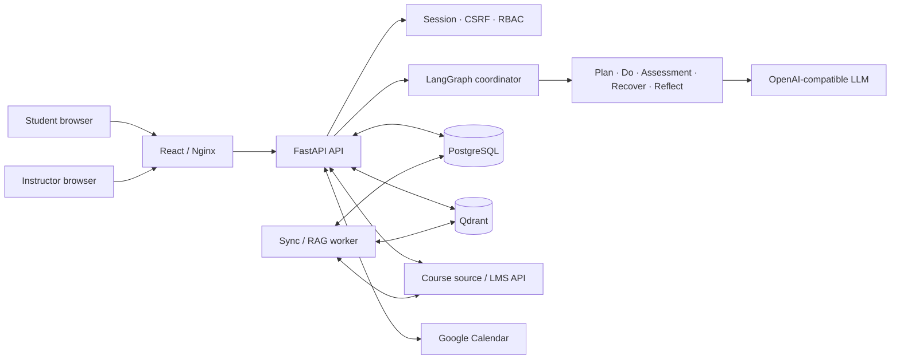
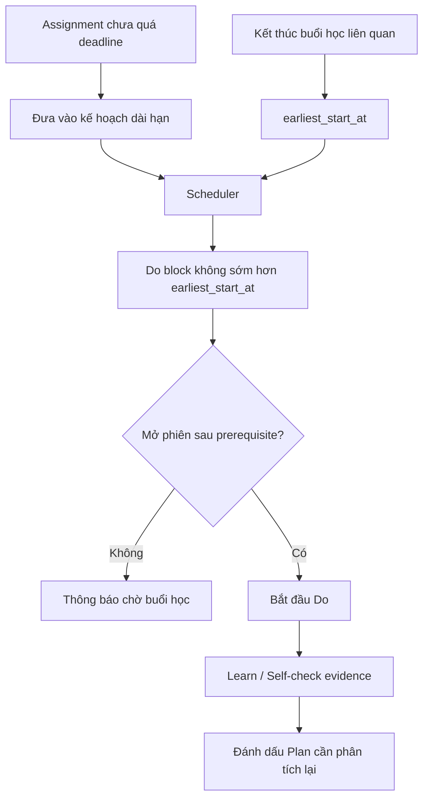

# 3. Architecture diagram

Sơ đồ kiến trúc đầy đủ và data flow:
[`../../architecture_diagram.md`](../../architecture_diagram.md).

## Tổng quan hệ thống

## Luồng Plan tương lai và prerequisite

Sơ đồ chi tiết còn có agent graph, sequence Plan → Do → Reflect, LMS sync/RAG,
data ownership, security boundary và deployment map.
